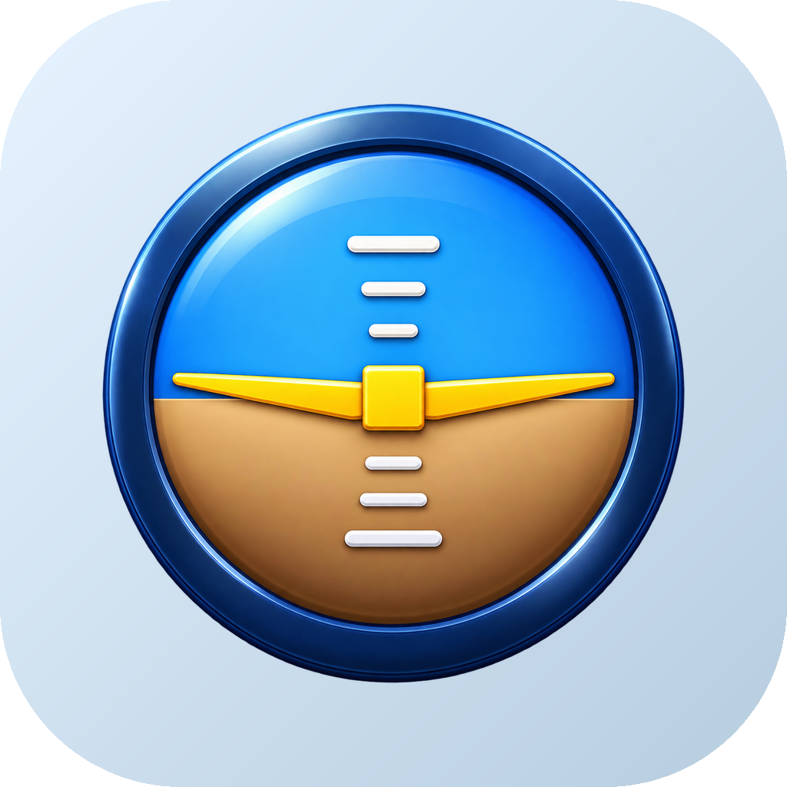

# OpenPFD

Aplikacja na Androida wyświetlająca realistyczny **Primary Flight Display** (Airbus A320, Boeing 737, Garmin G1000 SVT) oraz analogowy panel **Cessny 172** na pełnym ekranie zasilany **prawdziwymi danymi** z czujników telefonu i GPS.

| Parametr | Źródło |
|---|---|
| Pochylenie / przechylenie | wektor rotacji (żyroskop + akcelerometr + magnetometr) |
| Kurs magnetyczny | wektor rotacji |
| Kulka ślizgu (beta) | akcelerometr – przyspieszenie poprzeczne |
| Prędkość + trend 10 s | GPS (prędkość względem ziemi) |
| Kąt drogi, wektor toru lotu (FPV) | GPS + deklinacja magnetyczna (model WMM) |
| Wysokość, V/S | barometr (bez barometru: GPS MSL) |
| Wysokość nad terenem (RA), teren 3D | model terenu Open-Meteo (Copernicus DEM 90 m), siatka 10×10 co 3 km |
| Wiatr, OAT, TAS | prognoza Open-Meteo (10 m, 850/700/500 hPa) + trójkąt prędkości z GPS |
| **QNH** | najbliższy **METAR** (aviationweather.gov) → Open-Meteo `pressure_msl` → barometr + wysokość GPS |

## Obsługa
- PFD jest zawsze **kwadratowy, na środku ekranu**, działa w pionie i poziomie.
- Telefon trzymaj **pionowo, ekranem do siebie** (jak przyrząd na desce).
- **Długie przytrzymanie** – kalibracja poziomu.
- **Dotknięcie okna ciśnienia** – przełączenie QNH / STD.
- Przycisk **≡** – menu: motyw, kalibracja, hPa/inHg, FPV, aktualizacje.

## Przyrządy
A320, ATR 72-600, Boeing 737, 787, Embraer E190, Garmin G1000 z widokiem syntetycznym 3D,
panele analogowe: Cessna 172, Robinson R44 (z G-metrem), szybowiec (wariometr TE w m/s, km/h, metry).

## Ostrzeżenia
Callouty wysokości radiowej (2500…10), „bank angle”, „sink rate”, „pull up”, clacker przekroczenia prędkości,
stall horn oraz dźwiękowy wariometr szybowcowy. Menu → *Test ostrzeżeń* odtwarza wszystkie.

## Aktualizacje
Każdy wypchnięty tag `vX.Y.Z` buduje podpisany APK i publikuje **GitHub Release** o tej samej nazwie.
Aplikacja co 6 h (i przy starcie) sprawdza najnowszy release i proponuje instalację.

> Nie do nawigacji lotniczej.

---

**Projekt i wykonanie: [redzikowski.com](https://redzikowski.com)**

